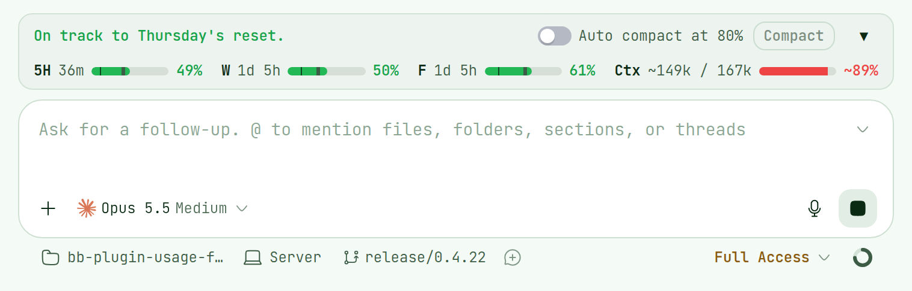
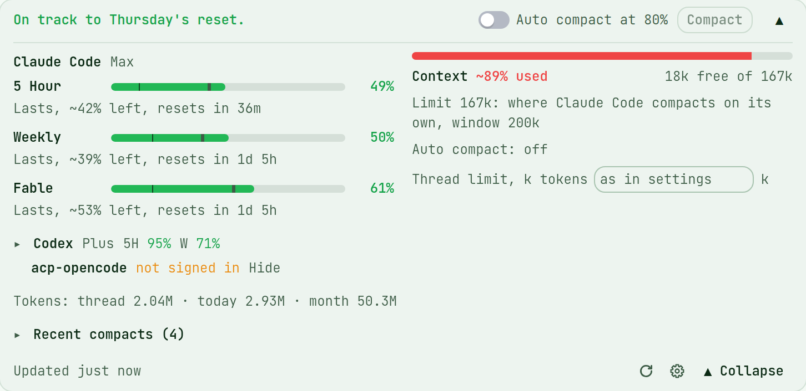
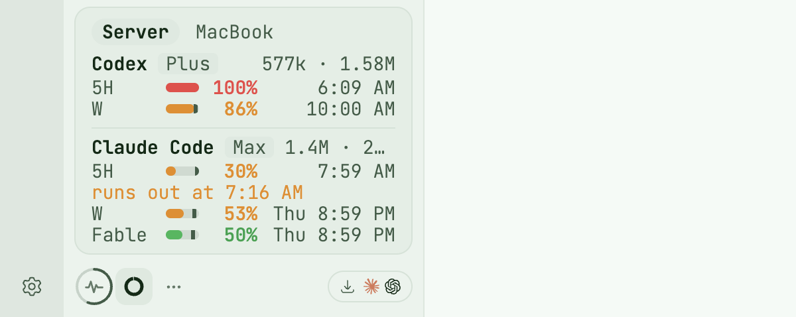
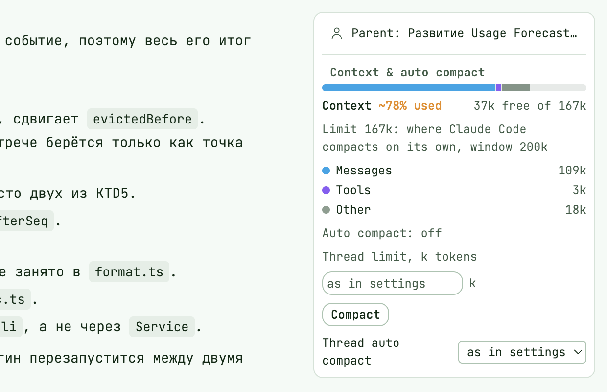
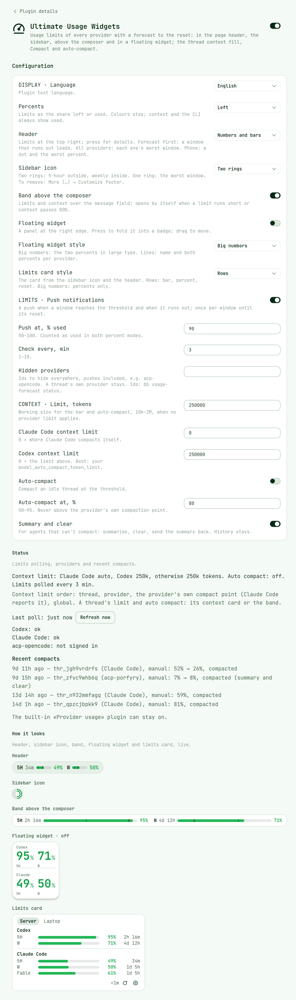

# Usage Forecast for BB

A [BB](https://getbb.app) plugin that shows how much of each agent provider's
usage limits is spent, forecasts where each window ends up at its reset, shows
how full the current thread's context window is and can compact a thread
before it overflows.

> [!NOTE]
> Version 0.4.3, tested with bb 0.49.0 and Plugin SDK 0.6.132. Limits appear
> only for providers that report them to bb (Claude Code and Codex today).

## Screenshots

The collapsed band above the composer: the headline with the forecast, the
auto-compact switch, the Compact button and one bar per limit window plus the
context bar. The ring in the sidebar footer (bottom left) shows the busiest
limit window.



The expanded band: every window of the thread's provider with its pace note,
the context breakdown, one line per other provider and the token totals.



The card behind the sidebar ring: every provider's windows, one tab per host.



The plugin's section of the thread context card.



The settings.



## What it does

- **Band above the composer.** Its design follows the band of
  `claude-code-usage-quota-mod`. The header has a headline («On track…»,
  «Tight. At this pace about 92% will be used by …», «At this pace you'll run
  out before the … reset.», «At this pace you'll run out in 20m.», «Limit
  reached…»), an
  auto-compact switch that names the threshold it acts at, and a Compact
  button. The collapsed
  row has a bar per limit window of the thread's provider (or of the worst
  provider) with time to reset, percent used and a marker where the pace ends
  at the reset, plus a context bar split into messages, tools and other.
  Collapsed, the band is two lines: the header and one row of bars with short
  labels (5H, W, F for Fable, Ctx), their bars stretched to fill the line.
  In a narrow band the bars shrink, then the reset times and bars drop out,
  and on a phone the switch and Compact show only when expanded.
  Expanded, it lists every window with a pace note («At this pace lasts to
  reset – about 92% used, resets in 3d», or «At this pace runs out Thu 4:00
  AM – 8h before reset» with a budget line «to last: up to 13% a day») and the
  context breakdown; the other providers are
  one line each («Codex · 5H 6% · W 56%») and the latest compacts one row,
  both opening on tap. The expanded part scrolls inside about half the screen
  height, so the header with its collapse button stays in view on a phone;
  there is a Collapse button at its bottom too. The expanded or collapsed state
  is kept per device. Every percent is the share used. A reset reads as a
  countdown in the rows of the band and the header («3d», «resets in 3d»)
  and as the local time in the cards («Thu 19:59», «19:59» today); the
  tooltip gives the other one. Every limit bar has a thin line where an even
  pace would be now, next to the grey forecast tick.
- **Forecast to the reset.** From the current pace of the window, and from
  the pace of past windows of the same kind once the server has seen enough of
  them. The current pace is the main forecast: the note, the colour, the tick
  and the headline follow it. In the first 5 % of a window the band says «Too
  early to judge» with the usual end from past windows, and does not warn.
  When the limit runs out before the reset, the note gives the local time it
  runs out, how long before the reset that is, and the rate that would last
  (per day for weekly windows, per hour for five-hour ones). The tooltip shows
  both paces and marks the main one.
- **Pace state and colour.** A window with a current pace has a state: calm
  (the projection at the reset is below 85 %), tight (85 % to 100 %), will
  not last (above 100 %), critical (it runs out within a tenth of the
  window's length from now) or used up. Calm is the normal colour, tight and
  will not last are amber, critical and used up are red; the bar, the
  percent, the note, the collapsed row and the choice of the provider shown
  follow it, and the headline speaks for the worst one. A worse state shows
  at once; a calmer one only after ten minutes of calmer polls, so the colour
  does not flicker while the text already says what the pace reads now. A
  window in its first 5 % or without a forecast has no state and stays
  grey; only a used-up limit is red. A host that cannot be read now shows its
  last values in grey, and the ring's and the header's tooltips say when they
  were measured. With no limits data at all the ring is a dashed circle and
  the header shows «—».
- **Context against a working limit.** The context bar, its percent and the
  auto-compact threshold are measured against a limit in tokens, not against
  the model window. The limit follows the provider: a thread's own limit,
  else a per-provider limit (Claude Code, Codex), else the point where the
  provider compacts on its own when bb reports it, else a global limit
  (150 000 by default). A model window smaller than the limit caps it. The
  context card and `bb usage-forecast thread` name which of these applied.
  An estimated fill (Codex between turns) is shown with `~`.
- **Context and auto-compact.** On the Mac a section «Context & auto
  compact» in the thread context card shows the fill in tokens, its
  breakdown, the limit, the compact button, the per-thread auto-compact mode
  (as in settings / off / on with its own threshold) and the per-thread
  limit. The band's switch turns the same per-thread mode on or off at the
  thread's threshold; the threshold itself is set in the settings or, for one
  thread, in the context card. When the threshold is already passed, turning
  the switch on asks whether to compact now or after the next reply. On the phone the context panel is in the expanded band.
- **Server-side work.** Limits are polled on the server, so history and
  auto-compact work with every client closed.
- **Every bb host.** Each connected host (the server and, for example, a Mac
  enrolled in the same bb) is polled on its own, with its own history and
  forecast, and a slow or failing host does not hold up the others. A thread
  shows only the limits of the host it runs on. When that host is
  disconnected or its last poll failed, the band keeps its last values with
  «Host unavailable, data from …» and no forecast; when the thread's host is
  not known, the band says so instead of showing another host. `bb
  usage-forecast status` lists every host; hosts signed in to one account
  show as one entry naming all of them, and get one push, whose title names
  the hosts when there is more than one. History collected before 0.4.6
  belongs to bb's primary host.
- **Limits in the page header.** At the top right of every page, next to
  bb's own header buttons, the open thread's provider shows its 5-hour and
  weekly windows (on a page without a thread: the provider of the worst
  window) in a pill: «5H 4h 41m 97%  W 61%», each percent in its window's
  colour, with the time to the 5-hour reset. «Numbers and bars» adds a
  horizontal bar with the pace ticks to each window. Pressing it
  opens the same card as the sidebar ring. On a phone the two windows stack
  in two lines and the bars drop out.
- **Refresh and settings in every card.** The expanded band, the sidebar
  card and the header card end with the time of the last poll, a button that
  polls the limits now and a button that opens the plugin's settings.
- **Ring in the sidebar footer.** A small ring next to bb's own footer
  buttons shows the worst limit window across every host: filled to its used
  percent and coloured by its pace state. The worst window is the one with
  the worst state (a window without a state counts as calm), then the higher
  percent, then the nearer reset; its tooltip names it, for example «laptop ·
  Claude Code · 5 Hour: 92%, critical». Pressing the ring opens a compact card
  with every provider's windows, one line each: a short label, the bar, the
  percent and the reset. The window's note is the line's tooltip; only a
  window that runs out before its reset names the time under its line
  («runs out at 3:39 PM»). With more than one
  host the hosts are tabs and the card shows one host at a time, first the
  host of the ring's worst window; an account shared by several hosts is in
  each of their tabs («also laptop»).
- **Plan multiplier.** When bb reports a plan multiplier above 1 (the
  host's `plan.multiplier`), the band, the sidebar card and the CLI show it
  after the plan name: «Claude Code · Max 5×». A label that already names a
  multiplier is left as it is. On bb 0.49.0 no provider sent one yet, so the
  plan name shows alone.
- **Hide providers you do not use.** The «Hidden providers» setting lists
  provider ids (`acp-opencode, codex`). A hidden provider drops out of the
  band's other providers, the sidebar ring and its card, limit pushes and
  `bb usage-forecast headroom`; a thread's own provider is always shown.
  Each other provider in the expanded band has a Hide button that adds it
  to the setting; to show it again, remove the id in the settings. Limits
  are still polled, and `bb usage-forecast status` lists every provider,
  hidden ones marked `[hidden]`.
- **Push before a limit runs out.** After each poll the server checks every
  limit window. When one reaches the threshold (90 % by default) it sends one
  push through bb's `push-notifications` plugin («Claude Code: 5 Hour limit at
  91%», «The limit resets in 2h.»), and one more when the window reaches
  100 %. A window stays quiet until it resets or drops below the threshold;
  what was sent is kept across restarts. The push carries the provider, the
  window and percents, no account data, and opens bb on tap. Without the
  `push-notifications` plugin, or with no device registered, the plugin only
  logs that the push was not delivered.
- **Token totals.** The server counts the tokens of every BB thread from
  bb's own token-usage events: per thread, and per provider for the local day
  and month. The expanded band has one line below the limit windows,
  «Tokens: thread 86k · today 310k · month 4.2M», where today and month are
  the thread's provider across all its BB threads; the tooltip gives the full
  sums with cache reads. The sidebar card adds today's and the month's sum
  («310k · 4.2M») to the heading of each provider that has any. The main number leaves cache reads out (they
  dominate long threads); the number in brackets is the provider's
  `totalTokens`. Only BB threads are counted: use of the same account outside
  BB is not, and Hermes ACP agents write no token events. After the first
  start the server walks every thread once (archived and hidden included)
  and from then on counts each thread when it goes idle.
- **Live context.** The server listens to the thread's context events
  (usage updated, compacted, cleared) and refreshes the open band at once;
  a poll every 30 s while the agent answers is only a backstop.

## Install

From the BB Community marketplace, once the entry is listed:

```sh
bb plugin install usage-forecast
```

From this repository, tracking compatible releases (`bb plugin update` picks
them up):

```sh
bb plugin install git:https://github.com/ponomr/bb-plugin-usage-forecast.git@^0.4.0
```

From a checkout, on the machine that runs the bb server:

```sh
git clone https://github.com/ponomr/bb-plugin-usage-forecast.git
cd bb-plugin-usage-forecast
npm ci && npm run build
bb plugin install "$PWD" --yes
bb plugin list   # usage-forecast … running
```

Update: `git pull && npm ci && npm run build && bb plugin install "$PWD" --yes`.

## Settings

Settings → Plugins → Usage Forecast, or `bb plugin config usage-forecast`.

| Setting | Default | Range | Meaning |
| --- | --- | --- | --- |
| Context limit, tokens | 150 000 | 10 000–2 000 000 | The global working limit: used when neither a provider limit nor the provider's own compaction point applies; a smaller model window caps it |
| Claude Code context limit, tokens | 0 (auto) | 0, 10 000–2 000 000 | Working limit for Claude Code threads; auto uses the point where Claude Code compacts on its own, as bb reports it |
| Codex context limit, tokens | 0 (auto) | 0, 10 000–2 000 000 | Working limit for Codex threads; bb reports no compaction point for Codex, so auto uses the global limit. Set it to your `model_auto_compact_token_limit` to measure against where Codex compacts |
| Auto-compact | off | — | Compact a thread when it goes idle with its context at or above the threshold |
| Auto-compact threshold, % | 80 | 50–95 | Fill of the context limit that triggers it |
| Summarise and clear when a provider cannot compact | off | — | For a provider without compaction (custom ACP agents such as Hermes), Compact and auto-compact ask the agent for a summary, clear the context and send the summary back |
| Limit push notifications | on | — | Push through the `push-notifications` plugin when a limit window reaches the threshold below, and again when it runs out |
| Limit push threshold, % | 90 | 50–100 | Usage of a limit window that sends the push |
| Limits poll interval, minutes | 2 | 1–10 | How often the server asks bb for limits |
| Language | English | English, Русский | Language of the plugin UI |
| Limits in the header | Numbers | Numbers, Numbers and bars, Off | The 5-hour and weekly windows at the top right of the page as coloured percents with the time to the 5-hour reset; with bars each window also gets a horizontal bar (not on a phone). Off removes them |
| Band above the composer | on | on, off | The limits and context band above the message field. Off: the band and its Compact button are gone; the context card, the sidebar ring, pushes and auto-compact work as before |
| Hidden providers | empty | provider ids, separated by commas or spaces | Providers left out of the band's other providers, the sidebar ring and card, limit pushes and `headroom`; a thread's own provider stays. Case does not matter; an unknown id is ignored. `bb usage-forecast status` prints the ids |

Auto-compact rules:

- It runs only between turns, on `thread.idle`.
- With the limit at the provider's own compaction point, every threshold
  (at most 95 %) lands below that point. When a thread or provider limit lies
  above the point where the provider compacts on its own, the plugin acts
  2 % of the window below that point (for Claude Code with a 200 000 window,
  which compacts at 167 000, a 200 000 limit acts at 81 % = 162 000 tokens).
  Codex reports no such point, so for Codex keep its limit at or below its
  `model_auto_compact_token_limit`.
- Large windows: with the provider limit on auto, the limit for Claude Code
  is the point where it compacts on its own, near the end of the window
  (167 000 of 200 000). With a much larger window (for example 1M tokens),
  that point, and every threshold below it, comes very late. To compact
  earlier, set the Claude Code or Codex context limit to the size you want to
  work with (for example 200 000); the threshold is then a percent of it.
- After a compact, or a failed attempt, a thread waits 10 minutes before the
  next one.
- A provider whose compact fails as unsupported (custom ACP agents such as
  Hermes) is skipped for 24 hours. With «Summarise and clear when a provider
  cannot compact» on, Compact and auto-compact do this instead: ask the agent
  for a summary that starts with `[context-summary]` (no tools, no file
  changes), wait for that turn (at most 10 minutes), check the answer is a
  summary, clear the thread's context (bb keeps the history visible) and send
  the summary back as the next message. Nothing is cleared without a summary,
  and a turn the user starts meanwhile cancels the run. The log marks such an
  entry «summary and clear». Clearing keeps less than a provider's own
  compact: only what the summary says.
- A per-thread override («Thread auto compact» in the context block, or the
  band's switch) wins over
  the global setting in both directions. The per-thread limit («Thread
  limit» in the context block, or `--limit` in the CLI) wins over the
  provider and global limits for that thread.

## CLI

```sh
bb usage-forecast status [--refresh] [--json]
bb usage-forecast headroom [--refresh] [--json] [--host <id or name> | --thread <threadId>]
bb usage-forecast thread <threadId> [--json]
bb usage-forecast compact <threadId>
bb usage-forecast override <threadId> inherit|off|on [--threshold 50-95] [--limit <tokens>|0]
bb usage-forecast tokens [--json]
```

`status` puts the state after the percent, for example
`Weekly limit: 60% [will not last], resets in 3d 0h, …` (`calm`, `tight`,
`will not last`, `critical`, `used up`; no bracket without a state).
In `status --json` every window also has a `verdict`, computed at the moment
of the call: `state` (the pace state, `early` or `unknown`), `lasts`,
`runsOutAt`, `projectedPercent`, `paceDeviationPercent` (used percent minus
an even spend so far) and `resetsInMs`. Every provider has `planMultiplier`
(a number above 1, or `null`) and `hidden` (from the «Hidden providers»
setting); the text marks a hidden provider `[hidden]` after its status.

`headroom` ranks provider accounts from the most headroom to the tightest by
their tightest window, for agents choosing where to send a job:

```text
Headroom, polled 2026-11-16 00:09 UTC (1m ago)
  1. codex (Plus): headroom – Weekly limit 57%, on pace for 69% at reset in 1d 6h
  2. claude-code (Max): tight – Current session 62%, on pace for 95% at reset in 1h 40m
  3. acp-x: unknown – not installed
```

Verdicts: `headroom` (every window calm), `tight`, `short`, `critical`,
`hit` (with when it is available again), `unknown`. `--host` or `--thread`
keeps one host's accounts; data older than 30 minutes is marked stale, for
the whole report or for one account (`measured 2d 3h ago`). Hidden providers
are left out of the ranking and listed in a last line `hidden: <ids>`
(`hidden` in JSON); with `--thread` the thread's own provider stays in.

`tokens` prints each provider's sums for the server's day and month, without
cache reads and, in brackets, with them, then the ten most recently counted
threads:

```text
Tokens in BB threads without cache reads (with them in brackets); day and month in UTC.
  claude-code: today 310k (2.5M), month 4.2M (31M)
  codex: today 5k (9k), month 7k (12k)
Recent threads:
  thr_a claude-code 86k
```

Until the first collection has read every thread it adds a line with its
progress. `--json` gives the same numbers in full.

Agents in bb threads get the same reference from
[skills/usage-forecast/SKILL.md](skills/usage-forecast/SKILL.md).

## Where the numbers come from

Only from BB itself (`bb.sdk.system.usageLimits` and `bb.sdk.threads.context`).
The plugin never calls a provider API and never reads provider credentials.
Account e-mail and account keys are dropped before anything is stored, and
e-mail addresses in error texts are masked.

## Limits

- Providers that bb does not report limits for (ACP agents, Cursor when it is
  not installed) are shown by status only.
- Summary and clear sends two messages into the thread on the user's behalf
  (the request and the summary), and both turns use the provider's limits.
- The learned forecast appears after the server has seen a window close
  (five hours for a session window, a week for a weekly one) and uses the last
  eight. The current-pace forecast waits until 5 % of the window has passed.
- A window without a known length (a label bb has not used before, no `kind`)
  has no forecast.
- Codex reports no context breakdown, only the total.
- Compacting an almost empty thread can make it larger; the log shows both
  numbers as they are.
- Poll back-off: 5 minutes after one failed poll, 15 after two in a row,
  counted per host. The `poll-limits` row of `bb plugin list` shows an error
  only while no connected host answers; one host's error is on that host in
  the band, in `status` and in the plugin log. A poll fails only when bb's call fails, the host does not answer
  within 30 s, or every provider reports an error; one provider's error stays
  on its own row.
- Two hosts count as one account for a provider only when bb reports the same
  account for both in one poll; the account itself is compared in memory and
  never stored.
- When a provider answers that it cannot compact, the plugin stops trying it
  for 24 hours; a successful manual compact lifts the mark earlier.
- Token totals are approximate. bb keeps only a thread's newest token-usage
  event, so the first collection books each thread's last known total in the
  hour of its last turn: the day and month of the first collection also hold
  what a long-running thread spent before them. For Claude Code that total
  covers only the provider's latest runtime run of the thread (it restarts
  its count with each run), so a thread's own total is a lower bound. From then on each idle thread adds what it grew; a count that
  dropped is a new run and counts in full, but a run that ends above the
  count remembered from the run before is counted only for the excess.
  Hourly sums and threads are kept for 40 days, under 200 KB each.

## Built-in provider usage

BB ships its own provider-usage plugin (`bb--provider-usage`). This plugin
does not touch it, and both can run side by side: they read the same bb data.
If two limit displays are too much, disable the built-in one in Settings →
Plugins.

## Turning it off

`bb plugin disable usage-forecast` removes the banner and stops polling and
auto-compact. Threads and providers stay unchanged, and the stored history is
kept for when the plugin is enabled again.

To hide only the band above the composer, switch off «Band above the
composer» in the plugin settings.

To hide only the header limits, set «Limits in the header» to Off.

To hide only the ring, open More in the sidebar footer → Customize footer →
«Remove Usage limits from footer»; it moves into the More menu. bb has no
plugin setting for this: a footer item cannot follow a setting.

## Development

See [AGENTS.md](AGENTS.md) for the commands, host facts and the release
contract.

## License

MIT. The forecast and the design of the band are adapted from
[`claude-code-usage-quota-mod`](https://github.com/anantraghunath/claude-code-usage-quota-mod)
by Anant Raghunath (MIT); no code of the mod is copied. See [NOTICE](NOTICE).
