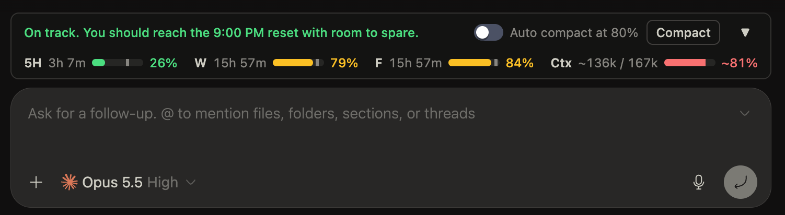
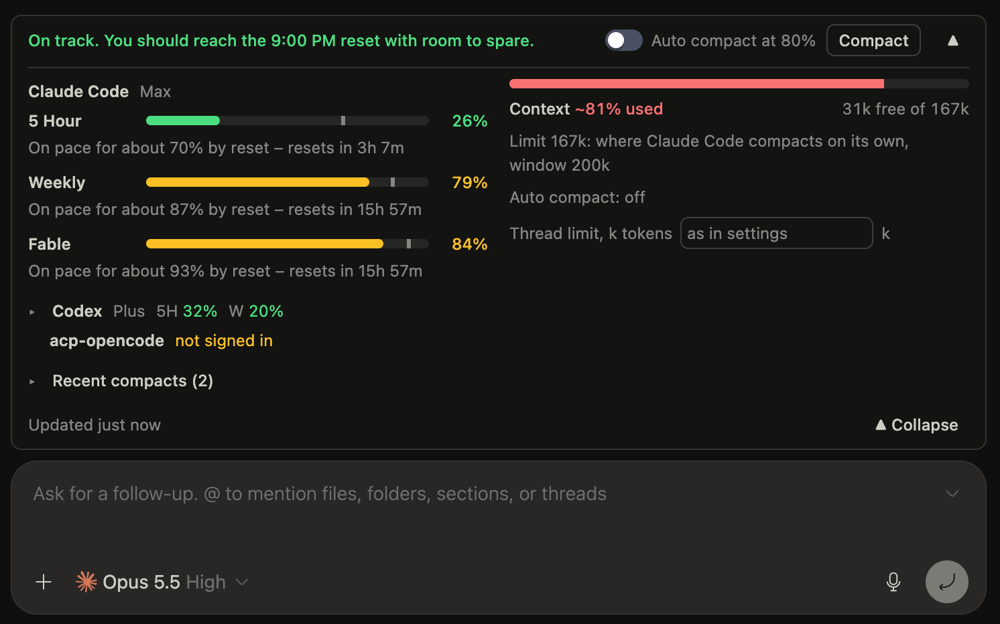

# Usage Forecast for BB

A [BB](https://getbb.app) plugin that shows how much of each agent provider's
usage limits is spent, forecasts where each window ends up at its reset, shows
how full the current thread's context window is and can compact a thread
before it overflows.

> [!NOTE]
> Version 0.3.0, tested with bb 0.49.0 and Plugin SDK 0.6.132. Limits appear
> only for providers that report them to bb (Claude Code and Codex today).

## Screenshots

The collapsed band above the composer: the headline with the forecast, the
auto-compact switch, the Compact button and one bar per limit window plus the
context bar.



The expanded band: every window of the thread's provider with its pace note,
the context breakdown and one line per other provider.



## What it does

- **Band above the composer.** Its design follows the band of
  `claude-code-usage-quota-mod`. The header has a headline («On track…»,
  «At this pace you'll run out before the … reset.», «Limit reached…»), an
  auto-compact switch with its threshold, and a Compact button. The collapsed
  row has a bar per limit window of the thread's provider (or of the worst
  provider) with time to reset, percent used and a marker where the pace ends
  at the reset, plus a context bar split into messages, tools and other.
  Collapsed, the band is two lines: the header and one row of bars with short
  labels (5H, W, F for Fable, Ctx), their bars stretched to fill the line.
  In a narrow band the bars shrink, then the reset times and bars drop out,
  and on a phone the switch and Compact show only when expanded.
  Expanded, it lists every window with a pace note («On pace for about 92% by
  reset – resets in 3d») and the context breakdown; the other providers are
  one line each («Codex · 5H 6% · W 56%») and the latest compacts one row,
  both opening on tap. The expanded part scrolls inside about half the screen
  height, so the header with its collapse button stays in view on a phone;
  there is a Collapse button at its bottom too. The expanded or collapsed state
  is kept per device.
- **Forecast to the reset.** From the current pace of the window, and from
  the pace of past windows of the same kind once the server has seen enough of
  them.
- **Context against a working limit.** The context bar, its percent and the
  auto-compact threshold are measured against a limit in tokens (150 000 by
  default), not against the model window: a 1M-window model fills the bar at
  the same point as a 200k one. A model window smaller than the limit caps
  it. One thread can have its own limit. An estimated fill (Codex between
  turns) is shown with `~`.
- **Context and auto-compact.** On the Mac a section «Context & auto
  compact» in the thread context card shows the fill in tokens, its
  breakdown, the limit, the compact button, the per-thread auto-compact mode
  (as in settings / off / on with its own threshold) and the per-thread
  limit. The band's switch sets the same per-thread mode; when the new
  threshold is already passed it asks whether to compact now or after the
  next reply. On the phone the context panel is in the expanded band.
- **Server-side work.** Limits are polled on the server, so history and
  auto-compact work with every client closed.
- **Live context.** The server listens to the thread's context events
  (usage updated, compacted, cleared) and refreshes the open band at once;
  a poll every 30 s while the agent answers is only a backstop.

## Install

From the BB Community marketplace, once the entry is listed:

```sh
bb plugin install usage-forecast
```

From this repository, tracking compatible releases (`bb plugin update` picks
them up):

```sh
bb plugin install git:https://github.com/ponomr/bb-plugin-usage-forecast.git@^0.3.0
```

From a checkout, on the machine that runs the bb server:

```sh
git clone https://github.com/ponomr/bb-plugin-usage-forecast.git
cd bb-plugin-usage-forecast
npm ci && npm run build
bb plugin install "$PWD" --yes
bb plugin list   # usage-forecast … running
```

Update: `git pull && npm ci && npm run build && bb plugin install "$PWD" --yes`.

## Settings

Settings → Plugins → Usage Forecast, or `bb plugin config usage-forecast`.

| Setting | Default | Range | Meaning |
| --- | --- | --- | --- |
| Context limit, tokens | 150 000 | 10 000–2 000 000 | The working limit the context bar and the threshold are measured against; a smaller model window caps it |
| Auto-compact | off | — | Compact a thread when it goes idle with its context at or above the threshold |
| Auto-compact threshold, % | 80 | 50–95 | Fill of the context limit that triggers it |
| Limits poll interval, minutes | 2 | 1–10 | How often the server asks bb for limits |
| Language | English | English, Русский | Language of the plugin UI |
| Limits show | Used | Used, Remaining | Each limit window as the percent used or the percent left, in its bar, number, pace tick and note; the context bar always shows what is used |

Auto-compact rules:

- It runs only between turns, on `thread.idle`.
- Claude Code compacts on its own at 78 % of its window, so for Claude Code
  threads the plugin acts a little below that point (76 % when the limit
  equals the window).
- After a compact, or a failed attempt, a thread waits 10 minutes before the
  next one.
- A per-thread override («Thread auto compact» in the context block, or the
  band's switch) wins over
  the global setting in both directions. The per-thread limit («Thread
  limit» in the context block, or `--limit` in the CLI) replaces the
  settings' limit for that thread.

## CLI

```sh
bb usage-forecast status [--refresh] [--json]
bb usage-forecast thread <threadId> [--json]
bb usage-forecast compact <threadId>
bb usage-forecast override <threadId> inherit|off|on [--threshold 50-95] [--limit <tokens>|0]
```

Agents in bb threads get the same reference from
[skills/usage-forecast/SKILL.md](skills/usage-forecast/SKILL.md).

## Where the numbers come from

Only from BB itself (`bb.sdk.system.usageLimits` and `bb.sdk.threads.context`).
The plugin never calls a provider API and never reads provider credentials.
Account e-mail and account keys are dropped before anything is stored, and
e-mail addresses in error texts are masked.

## Limits

- Providers that bb does not report limits for (ACP agents, Cursor when it is
  not installed) are shown by status only.
- The learned forecast appears after the server has seen a window close
  (five hours for a session window, a week for a weekly one) and uses the last
  eight. The current-pace forecast waits until 5 % of the window has passed.
- A window without a known length (a label bb has not used before, no `kind`)
  has no forecast.
- Codex reports no context breakdown, only the total.
- Compacting an almost empty thread can make it larger; the log shows both
  numbers as they are.
- Poll back-off: 5 minutes after one failed poll, 15 after two in a row; the
  last error is on the `poll-limits` row of `bb plugin list`. A poll fails
  only when bb's call fails or every provider reports an error; one
  provider's error stays on its own row.
- When a provider answers that it cannot compact, the plugin stops trying it
  for 24 hours; a successful manual compact lifts the mark earlier.

## Built-in provider usage

BB ships its own provider-usage plugin (`bb--provider-usage`). This plugin
does not touch it, and both can run side by side: they read the same bb data.
If two limit displays are too much, disable the built-in one in Settings →
Plugins.

## Turning it off

`bb plugin disable usage-forecast` removes the banner and stops polling and
auto-compact. Threads and providers stay unchanged, and the stored history is
kept for when the plugin is enabled again.

## Development

See [AGENTS.md](AGENTS.md) for the commands, host facts and the release
contract.

## License

MIT. The forecast and the design of the band are adapted from
[`claude-code-usage-quota-mod`](https://github.com/anantraghunath/claude-code-usage-quota-mod)
by Anant Raghunath (MIT); no code of the mod is copied. See [NOTICE](NOTICE).
