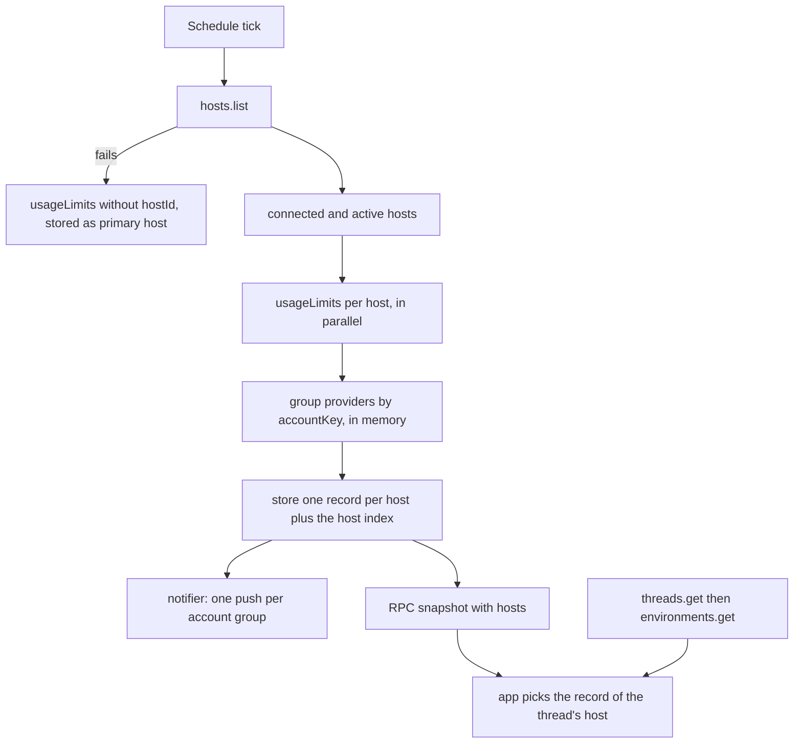

# Per-Host Usage Limits - Plan

## Goal Capsule

- **Objective:** Every thread shows the usage limits of the account it really runs on, so the forecast, the warning colour and the push notifications are true on every host, not only on the server.
- **Product authority:** The maintainer confirmed the scope below on 2026-11-15. Tracker task: UF-5.
- **Open blockers:** None.
- **Means:** Per-host polling and per-host stored records, with the thread's host resolved on the server (KTD1, KTD3).
- **Authority:** `AGENTS.md` Critical Rules override this plan; the Product Contract overrides the Planning Contract and the units.
- **Execution profile:** One branch, test-first for the server units, commits per unit. The executor commits locally and does not push, open a PR, tag or release; the coordinating thread reviews, merges and releases.
- **Stop conditions:** Stop and report instead of working around it when an SDK call named in KTD3 or KTD4 behaves differently from what is stated here, or when a requirement cannot be met without storing an account identifier.

---

## Product Contract

### Summary

The plugin polls usage limits for every connected host instead of the server host only. A thread shows the windows of its own host. The CLI and the push notifications cover every account and name the host; an account shared by several hosts appears once.

### Problem Frame

The poller asks bb for limits without naming a host, and bb answers for the server host. A thread on another host therefore shows another account's numbers whenever the two hosts are signed in to different accounts.

Observed on 2026-11-15 on the maintainer's install (server host plus one Mac host), by asking bb for limits with and without a host:

| Provider | Server host (what the plugin stores today) | Mac host |
| --- | --- | --- |
| Codex | plan Plus, session 18 %, week 57 % | a different account, plan K12, session 2 %, week 5 % |
| Claude Code | session 24 %, week 27 %, Fable 23 % | the same account, the same windows and reset times |

A Codex thread on the Mac shows 57 % of the week where the truth is 5 %. The Claude Code rows show the opposite case: one account on two hosts, which must not turn into two copies of the same windows.

Other installs differ: one host only, several hosts on one account, or a different account on every host. The behaviour below must hold for all of them and must not assume this install's host names, count or roles.

### Key Decisions

- **A thread shows its own host only.** No line about other hosts in the thread, even when another host has room. Governs R3, R4. (session-settled: user-directed — chosen over a hint line shown when the own window runs short, and over an always-present collapsed "other hosts" line: the thread view stays simple, and the all-hosts view lives in the CLI.)
- **Data stored before this change belongs to the host bb answers for when no host is named.** That is the only host the plugin has ever polled, on any install. Governs R9. (session-settled: user-approved — chosen over starting every host with empty history: the learned forecast survives the upgrade. The maintainer added that the rule must be generic, not written for this install.)
- **A disconnected host keeps its last values, marked stale.** Governs R6. (session-settled: user-approved — chosen over hiding the host: last-known numbers with their time are more useful than an empty band.)
- **One push per account, not per host.** Governs R8. (session-settled: user-approved — chosen over one push per host: a shared account would otherwise notify twice for one event.)
- **Every connected host is polled at the existing interval; there is no setting to choose hosts.** Governs R1. (session-settled: user-approved — chosen over a per-host on/off setting: nobody asked for it.)

### Requirements

**Polling**

- R1. The plugin polls usage limits for every host that is connected at poll time, at the existing poll interval.
- R2. A host that fails or does not answer does not stop or delay the other hosts' results, and the back-off after failures is counted per host.

**Thread view**

- R3. The composer band and the context card of a thread show the limit windows of the host that thread runs on, with the forecast computed from that host's own samples and history.
- R4. The thread view shows no windows of any other host.
- R5. On an install with one host the thread view looks and behaves exactly as before this change.
- R6. When the thread's host is disconnected or its poll fails, the thread view keeps the last values of that host and says they are stale and from what time; it shows no forecast computed past that time as current.

**All-hosts view**

- R7. The CLI status lists the limits of every polled host with the host's name; hosts that share one account for a provider are listed once for that provider, naming all of those hosts. On an install with one host the output keeps its current shape.
- R8. A limit push notification is sent once per account and window period, however many hosts share the account, and its text names the host or hosts when the install has more than one host. Push texts stay in both languages.

**Stored data**

- R9. After the upgrade, samples, closed-window history and the learned forecast collected earlier belong to the host bb answers for when no host is named, and nothing collected earlier is lost.
- R10. No account identifier is stored or logged. Whether two hosts share an account is decided from the answers of one poll in memory, and only the resulting grouping of hosts may be stored.
- R11. Every stored value stays under the existing size bound with any number of hosts, by trimming as the buffers do today.
- R12. A host that is removed from bb stops appearing in the thread view, the CLI and pushes, and its stored data does not grow.

### Acceptance Examples

- AE1. **Covers R3, R4.** Given the server host with Codex at week 57 % and a Mac host on another Codex account at week 5 %, when a Codex thread on the Mac is open, then its band shows week 5 % and nothing about 57 %.
- AE2. **Covers R7, R8.** Given Claude Code signed in to the same account on both hosts, when the CLI status runs, then Claude Code appears once with both host names; when that account's weekly window crosses the push threshold, then one push arrives.
- AE3. **Covers R7.** Given Codex on different accounts on the two hosts, when the CLI status runs, then Codex appears twice, each with its host name, plan and windows.
- AE4. **Covers R2, R6.** Given the Mac host goes offline, when the next poll runs, then server-host threads update as usual, and a Mac thread opened later shows the Mac's last values with a stale mark and their time.
- AE5. **Covers R9.** Given an install upgraded with stored history, when the first poll after the upgrade finishes, then a thread on the default host shows the same learned forecast basis as before, and a thread on another host starts with no history.
- AE6. **Covers R5, R7.** Given an install with one host, when the upgrade is applied, then the band, the context card and the CLI status read as they did before.

### Scope Boundaries

- A hint in the thread that another host has room is out; the agent-facing answer to "who has room" belongs to UF-10.
- The always-visible sidebar indicator is UF-8; it will read the per-host data this work produces but is not built here.
- The plan label differs for one Claude Code account across the two hosts (Max and Pro). Showing or reconciling plan labels is UF-11.
- No setting to include or exclude hosts from polling.
- The built-in `bb--provider-usage` plugin is not touched.

### Dependencies / Assumptions

- bb's `system.usageLimits` accepts an optional `hostId`; with it the answer is that host's limits, without it the primary host's (observed 2026-11-15, see Problem Frame).
- `hosts.list()` returns every host with `id`, `name`, `status` (`connected` or `disconnected`), `type` and `lifecycle.phase`. A thread has `environmentId`, and `environments.get` returns that environment's `hostId`. `system.config()` returns `primaryHostId`, which equalled the host answered without `hostId` (all read from the SDK types and checked live on 2026-11-15).
- Assumption: two hosts whose answers for a provider carry the same `accountKey` share that provider's account. The key is compared in memory only (R10). `accountKey` is undocumented; when it is missing the hosts are treated as separate accounts.

### Outstanding Questions

**Deferred to Implementation**

- Whether polling every host with `refresh: true` each interval has a visible cost on the host side. Hosts are polled in parallel; stagger only if the live test shows a problem.

### Sources / Research

- `src/server/poller.ts` — the poll, back-off and `PollerDeps.usageLimits`, called without a host.
- `src/server/storage.ts` — KV keys (`limits:latest`, `limits:samples:<provider>`, `limits:windows:<key>`, `notify:sent`) and the ring buffers.
- `src/server/limit-notifier.ts` — push at the threshold and at 100 %, one per provider and window label.
- `src/server/cli.ts` — `formatStatus`, the all-providers listing.
- `src/shared/contract.ts` — `providerLimitsSchema`, the shape the app receives.
- `node_modules/@get-bb/plugin-sdk/bundled-types/bb-plugin-sdk.d.ts` — `systemUsageLimitsQuerySchema` with `hostId`, `providerId`, `refresh`.
- `AGENTS.md` — Critical Rules 1, 2, 5, 6 and Host facts.
- `test/helpers.ts`, `test/poller.test.ts`, `test/limit-notifier.test.ts`, `test/cli.test.ts`, `test/banner.test.tsx`, `test/app-fixtures.tsx` — the fakes and fixtures to extend.

Product Contract preservation: Product Contract unchanged, except that the questions deferred to planning are answered in the Planning Contract and the dependency checks are recorded as done.

---

## Planning Contract

### Key Technical Decisions

- KTD1. **Stored state is one record per host; the primary host keeps today's keys.** `limits:latest` becomes the primary host's record unchanged, and its samples and closed-window keys stay as they are. Every other host gets keys with its host id in them (`limits:latest:<hostId>`, `limits:samples:<hostId>:<provider>`, `limits:windows:<hostId>:<windowKey>`). A small index key lists the known hosts with name, connected flag, poll time, poll error and which host owns the legacy keys. The owner of the legacy keys is written once, at the first poll after the upgrade, from `system.config().primaryHostId`, and never changes afterwards. The marker is written only when that value is a non-empty string; when it is null and `hosts.list` returns exactly one host, that host is used. Until the marker exists (config failed, or null with several hosts) the poller makes today's single call without `hostId`, keeps it on the legacy keys with no host id, and skips per-host polling and index writes; the app treats that record as the only host. This satisfies R9 with no data copy and keeps every value small (R11). Rejected: one value holding all hosts (grows with hosts toward the 256 KB bound) and rewriting old data under new keys (a migration that can fail half-way).
- KTD2. **Account sharing is a per-poll grouping, stored as host ids only.** After the hosts of one poll have answered, providers with equal `accountKey` across hosts form a group. Each host's provider record stores `sharedWith: string[]` (the other host ids of its group, sorted). A host that did not answer this poll keeps its previous `sharedWith`. Every host still keeps its own samples and history, so a forecast never counts one account twice. `accountKey` and `accountEmail` never reach `Storage`, the log, the RPC output or an error message (R10). Governs R7, R8.
- KTD3. **The server resolves a thread's host and the app selects by it.** `readThreadState` reads `environmentId` from `threads.get`, then `hostId` from `environments.get`, and returns it as `ThreadState.hostId` (nullable). The app picks the host record whose id equals the thread's host. When the host cannot be resolved: with one known host the app uses it; with several it shows the existing "reasons" state with a text that the thread's host is unknown, never another host's windows. The single-host fallback applies only when the thread's host id is null: a thread whose host resolved but has no stored record yet (first poll not finished, or the host was dropped) shows the same "host unknown" state, even when one other host is known. No cache of the thread-to-host mapping is built; add one only if U6 shows a visible delay. Governs R3, R4, R5.
- KTD4. **One schedule, hosts polled in parallel, back-off per host.** Each tick lists hosts, keeps those with `status: connected` and `lifecycle.phase: active`, and polls each with `usageLimits({ hostId, refresh: true })` through `Promise.allSettled`. Failure counters and back-off times live in a map by host id. The tick throws, naming the hosts, only when a polled host failed, so `bb plugin list` keeps showing failures. When `hosts.list` itself fails, the poller falls back to today's single call without `hostId` and stores it under the legacy owner (or, with no marker yet, as described in KTD1). Governs R1, R2.
- KTD5. **Hosts that leave are cleaned up.** A host absent from `hosts.list`, or with `lifecycle.phase: destroyed`, is dropped from the index and its keys are deleted with `kv.list(prefix)` and `kv.delete`. The legacy keys are never deleted this way. The index holds at most 20 hosts; beyond that the hosts polled longest ago are dropped first. Governs R12, R11.
- KTD6. **The RPC snapshot carries hosts; top-level fields stay.** `snapshotSchema` gains `hosts: HostLimits[]`, each with `hostId`, `name`, `connected`, `polledAt`, `pollError` and `providers`. Top-level `polledAt` and `pollError` stay as the newest poll and the combined error. Top-level `providers` is removed: the app and the server ship in one package, so no outside reader exists. Its three readers are `src/app/model.ts`, `src/server/cli.ts` and `src/app/settings-section.tsx`; the settings section only needs provider ids and takes their union across hosts, so it looks the same as today. `toSnapshot` clears the forecast of every window of a host that is disconnected or whose last poll failed, as it already does for a window whose reset has passed. Governs R6.
- KTD7. **Push dedupe is by group, remembered per host key.** The notifier walks account groups, not hosts. A group counts as already notified for a period when any member host's key holds that period; after sending, the entry is written under every member's key. The primary host's key stays `windowKey(providerId, label)` so pushes remembered before the upgrade are not repeated. Governs R8.
- KTD8. **Release as 0.4.6.** The marketplace entry tracks `^0.4.0`, and this is a fix with no manifest or permission change. The executor bumps the version and writes the changelog entry in the branch; tagging and release stay with the coordinating thread.

### High-Level Design

The diagram is directional. Names and signatures are the executor's to choose within the decisions above.

### Sequencing

U1, then U2, then U3 and U4 (independent of each other), then U5, then U6.

---

## Implementation Units

### U1. Per-host storage

- **Goal:** `Storage` reads and writes limits per host, with the primary host on the legacy keys and a bounded host index.
- **Requirements:** R9, R11, R12.
- **Dependencies:** none.
- **Files:** `src/server/storage.ts`, `test/helpers.ts`, `test/limits.test.ts` or a new `test/storage-hosts.test.ts`.
- **Approach:** Add a host scope argument to `latest`, `setLatest`, `samples`, `appendSamples`, `closedWindows`, `appendClosedWindow`. Add the host index (read, write, cap of 20) and the legacy-owner marker per KTD1. Add `removeHost(hostId)` per KTD5. Values in an unexpected shape read as empty, as the other readers do.
- **Test scenarios:**
  - Data written before the change through the legacy keys is returned for the host marked as legacy owner, unchanged.
  - Two hosts write samples for the same provider and each reads only its own.
  - `removeHost` deletes that host's keys and leaves the legacy keys and other hosts intact; removing the legacy owner's host id does not delete legacy keys.
  - The index never exceeds 20 hosts and drops the host polled longest ago.
  - A sample buffer near the byte bound is trimmed for a scoped key exactly as for a legacy key.
- **Verification:** `npm run typecheck && npm test`.

### U2. Poll every host

- **Goal:** The poller polls each connected host, stores per-host records, groups shared accounts and cleans up departed hosts.
- **Requirements:** R1, R2, R6, R10, R12.
- **Dependencies:** U1.
- **Files:** `src/server/poller.ts`, `server.ts`, `src/shared/contract.ts` (`sharedWith` on the provider record, `HostLimits`, snapshot shape per KTD6), `test/poller.test.ts`.
- **Approach:** `PollerDeps` gains `hosts()` and `primaryHostId()`, and `usageLimits` takes an optional `hostId`. Implement KTD4, KTD2 and KTD5. Read `accountKey` from the raw answer inside the poller only, for grouping, and drop it with `accountEmail` before anything is stored or logged; add both to the test that asserts stored and logged data carry no account fields. `afterPoll` receives the per-host records. `toSnapshot` builds the hosts list and clears forecasts of stale hosts.
- **Test scenarios:**
  - Two hosts with different Codex accounts: each record holds its own windows; `sharedWith` is empty for Codex.
  - Two hosts with the same Claude Code `accountKey`: both records list each other in `sharedWith`; nothing stored or logged contains the key or the email.
  - One host throws: the other host's record is stored and fresh; the failed host keeps its previous windows with its `pollError`; only the failed host backs off on the next ticks.
  - A disconnected host is not polled, keeps its record, and is marked not connected; its windows lose their forecast in the snapshot.
  - A host absent from the list is removed from the index and its keys are gone.
  - `hosts.list` fails: one call without `hostId` is made and stored as the primary host.
  - One host only: the stored primary record equals what the poller stored before this change for the same answer.
  - First poll after an upgrade with existing legacy data: the primary host continues its open windows and closed-window history; a second host starts empty.
  - First poll with `primaryHostId` null and two hosts, and first poll with `config()` throwing: one call without `hostId` is stored on the legacy keys, no marker and no index are written, and existing legacy data is intact; a later poll with a known primary host writes the marker and starts per-host polling.
  - A provider answer without `accountKey` on either host is never grouped.
- **Verification:** `npm run typecheck && npm test`.

### U3. Thread host and thread view

- **Goal:** A thread's band and context card show its own host's windows, with a stale mark when that host is unavailable.
- **Requirements:** R3, R4, R5, R6.
- **Dependencies:** U2.
- **Files:** `src/server/threads.ts`, `server.ts` (wire `environments.get`), `src/shared/contract.ts` (`ThreadState.hostId`), `src/app/model.ts`, `src/app/banner.tsx`, `src/app/context-row.tsx` if it reads limits, `src/app/settings-section.tsx`, `test/settings.test.tsx`, `src/app/i18n.ts`, `test/banner.test.tsx`, `test/app-fixtures.tsx`, `test/context-row.test.tsx`.
- **Approach:** Implement KTD3. `bannerView` takes the host record instead of the whole snapshot's providers; the primary and "other providers" rows both come from that record. The stale mark reuses the existing "last good data from" pattern, with new strings in English and Russian for "host unavailable" and "host unknown". A failure to resolve the host must not fail the whole thread state.
- **Test scenarios:**
  - Covers AE1. Snapshot with two hosts and a thread on the second: the band shows the second host's Codex week value and no element carries the first host's value.
  - Covers AE6. Snapshot with one host: rendered output matches the existing single-host expectations with no host name shown.
  - Covers AE4. The thread's host is not connected: values are shown with the stale text and time, and no forecast text is rendered.
  - Thread host unresolved with two hosts known: the "host unknown" reasons state is shown and no windows.
  - Thread host unresolved with one host known: that host's windows are shown.
  - Thread host resolved but absent from the snapshot, one other host known: the "host unknown" state is shown and no windows.
  - Settings section with two hosts that both have Codex: Codex is listed once.
  - `environments.get` throws: thread state still returns context data, with `hostId` null.
- **Verification:** `npm run typecheck && npm test`.

### U4. CLI status and push across hosts

- **Goal:** The CLI lists every account once with its host names, and a shared account produces one push.
- **Requirements:** R7, R8.
- **Dependencies:** U2.
- **Files:** `src/server/cli.ts`, `src/server/limit-notifier.ts`, `src/app/i18n.ts`, `src/app/format.ts` if a host-name formatter belongs there, `test/cli.test.ts`, `test/limit-notifier.test.ts`.
- **Approach:** `formatStatus` walks account groups: with one host the output is byte-for-byte today's; with several, each provider line names its host or hosts, and a not-connected host says so with the time of its data. A shared-account block prints the plan label and windows of the member host that answered most recently (the primary host on a tie) and names every member host. The notifier implements KTD7; push titles and bodies gain the host name or names only when more than one host is known.
- **Test scenarios:**
  - Covers AE2. Shared Claude Code account on two hosts: one CLI block naming both hosts; crossing the threshold sends one push; the next poll sends none.
  - Covers AE3. Different Codex accounts: two CLI blocks, each with its host name and plan.
  - Covers AE6. One host: `formatStatus` output equals the current snapshot test expectation.
  - A push remembered before the upgrade under the legacy key is not sent again for the same period.
  - The group's first host goes offline between polls: no second push for the same period.
  - Push text in Russian and English contains the host name with two hosts and no host name with one.
- **Verification:** `npm run typecheck && npm test`.

### U5. Documentation and version

- **Goal:** The repository describes the new behaviour and carries the release version.
- **Requirements:** R1, R7 (documentation of behaviour).
- **Dependencies:** U3, U4.
- **Files:** `AGENTS.md` (Host facts: per-host limits, `primaryHostId`, thread to environment to host; Critical Rule 2 already covers `accountKey`), `README.md`, `CHANGELOG.md`, `package.json`, `package-lock.json`.
- **Approach:** Version 0.4.6 per KTD8. Changelog entry in the file's existing style. Host facts state only what was observed, with the date.
- **Test scenarios:** Test expectation: none -- documentation and version only.
- **Verification:** `npm ci && npm run typecheck && npm test && npm run build`.

### U6. Live check on the two-host install

- **Goal:** Proof on the real server that the numbers per host are right.
- **Requirements:** R1, R3, R7, R9.
- **Dependencies:** U5.
- **Files:** none.
- **Approach:** Install from the branch checkout with `npm run build && bb plugin install "$PWD" --yes`. Compare the plugin's CLI status with bb's own answer per host, printing percents and plan labels only, never account fields. Open or query one thread per host through the plugin RPC `thread` and `snapshot`. Record what was observed in the final report; add a Host facts line only for facts actually seen.
- **Test scenarios:** Test expectation: none -- live verification.
- **Verification:** `bb plugin list` shows the new version `running`; `bb plugin logs usage-forecast` shows no error and no account identifier; the CLI status shows Codex twice with different values and Claude Code once with both host names; the learned forecast basis of the primary host is not reset.

---

## Verification Contract

| Gate | Command or check | Applies to |
| --- | --- | --- |
| Types | `npm run typecheck` | every unit |
| Tests | `npm test` | U1 to U4 |
| Full check | `npm ci && npm run typecheck && npm test && npm run build` | before the final report |
| No account identifiers | a test asserts that no stored value, log line or RPC output contains the fixture's `accountKey` or `accountEmail` | U2 |
| Single-host parity | existing single-host tests pass with expectations unchanged | U2, U3, U4 |
| Live | the checks of U6 | U6 |

## Definition of Done

- Every requirement R1 to R12 is covered by a passing test or by an observation recorded from U6.
- The full check passes on the branch.
- No stored value, log line, RPC output or error text contains an account identifier.
- UI and push strings exist in English and Russian in `src/app/i18n.ts`; code, comments and docs are English.
- Vendored `components/`, `lib/`, `hooks/` are unchanged; the built-in `bb--provider-usage` plugin is untouched.
- No abandoned experiment, debug output or unused code remains in the diff.
- Work is committed locally on its branch, not pushed; the final report lists the commits, the test results, what U6 showed and anything that differed from this plan.
